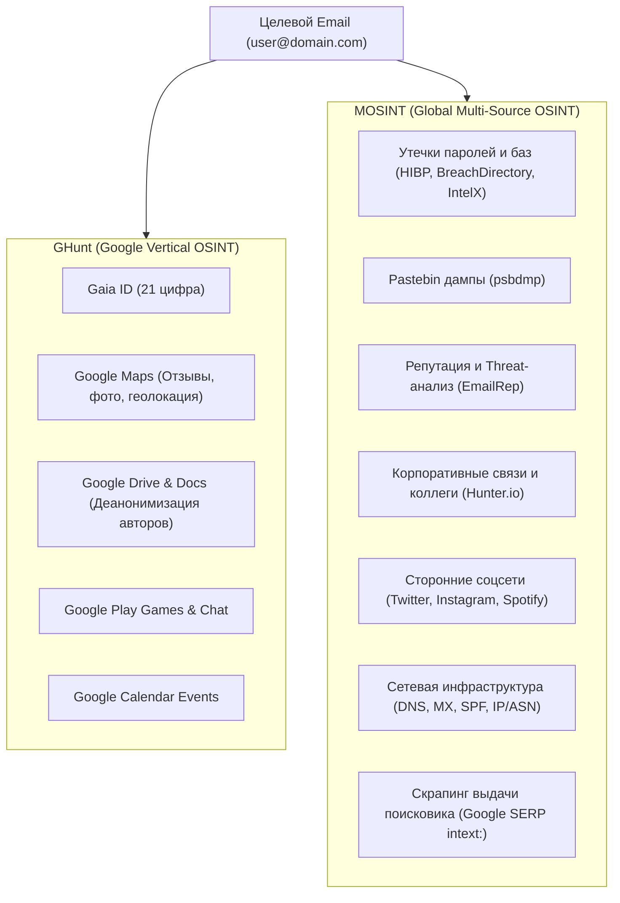

# Сравнительный анализ MOSINT и GHunt: Уникальный функционал MOSINT

> **Проект MOSINT:** [https://github.com/alpkeskin/mosint](https://github.com/alpkeskin/mosint) (версия v3.x, язык Go)  
> **Проект GHunt:** [https://github.com/mxrch/GHunt](https://github.com/mxrch/GHunt) (версия v2.3.4+, язык Python)  
> **Дата анализа:** Ноябрь 2026 г.  
> **Цель:** Идентификация и подробный разбор возможностей MOSINT, полностью отсутствующих в GHunt.

---

## 1. Концептуальная разница архитектур и целей

Для объективного понимания различий важно зафиксировать фундаментальную разницу в назначении обоих инструментов:

* **GHunt** — это **вертикальный глубокий фреймворк для экосистемы Google**. Он исследует закрытые внутренние API Google (People API, Play Games, Google Maps, Calendar, Drive), опираясь на эмуляцию Android Play Services и авторизацию через Google-сессии (Master Token, SAPISID, OSID). Его цель — извлечь максимум данных из профиля Google и привязанного к нему 21-значного `Gaia ID`.
* **MOSINT** — это **горизонтальный агрегатор глобальной разведки по Email (Threat & Breach Intelligence)**. Он написан на Go и исследует адрес электронной почты по всему интернету: базы утечек, даркнет-дампы, репутационные скоринги, внешние социальные сети (Instagram, Twitter, Spotify), корпоративную структуру домена и DNS/IP-инфраструктуру.



---

## 2. Сводная матрица возможностей (GHunt vs MOSINT)

| Категория возможностей | Функция / Источник данных | GHunt | MOSINT | Примечание |
|---|---|:---:|:---:|---|
| **Валидация адреса** | Синтаксическая проверка RFC / Regex | ❌ | **Да** | Встроенный модуль `emailverifier` |
| **Утечки баз данных** | Проверка факта утечки аккаунта | ❌ | **Да** | Интеграция с HaveIBeenPwned API v3 |
| **Утечки паролей** | Поиск открытых паролей и SHA1-хешей | ❌ | **Да** | Интеграция с BreachDirectory API |
| **Даркнет и архивы** | Поиск документов и дампов в архивах | ❌ | **Да** | Интеграция с Intelligence X (IntelX SDK) |
| **Pastebin Dumps** | Поиск по публичным текстовым дампам | ❌ | **Да** | Интеграция с `psbdmp.ws` (без API-ключа) |
| **Репутация и риски** | Анализ подозрительности и спам-листов | ❌ | **Да** | Скоринг через `EmailRep.io` |
| **Почтовые политики** | Анализ MX, SPF, DMARC, защита от спуфинга | ❌ | **Да** | EmailRep + собственный DNS Resolver |
| **Сетевой OSINT** | Определение A, MX, TXT, CNAME записей | ❌ | **Да** | Встроенный DNS-резолвер `dnsr` |
| **IP-геолокация домена**| ASN, провайдер, город, страна сервера | ❌ | **Да** | Сервис `ipapi.co` |
| **B2B / Корпоративные связи** | Поиск коллег и шаблона именования почты | ❌ | **Да** | Интеграция с `Hunter.io` Domain Search |
| **Сторонние соцсети** | Проверка Instagram, Twitter (X), Spotify | ❌ | **Да** | Нативные HTTP-чекеры через формы регистрации |
| **Внешний Web-поиск** | Поиск публичных упоминаний на веб-страницах | ❌ | **Да** | Скрапер поисковой выдачи Google (`colly`) |
| **Внутренние сервисы Google** | Gaia ID, Maps, Drive, Calendar, Games | **Да** | ❌ | Прерогатива GHunt |
| **Требование Google-аккаунта**| Необходимость сессионных кук Google | **Да** | ❌ | MOSINT не требует Google-аккаунта |

---

## 3. Детальный разбор уникального функционала MOSINT

Ниже подробно рассмотрен весь функционал, присутствующий в MOSINT (`v3/pkg/`), но **полностью отсутствующий в GHunt**.

### 3.1. Разведка утечек данных и скомпрометированных паролей

GHunt не имеет механизмов работы с базами скомпрометированных учетных записей. MOSINT закрывает этот спектр четырьмя специализированными модулями:

#### 1. HaveIBeenPwned (`v3/pkg/services/haveibeenpwned/`)
* **Механика:** Обращается к официальному API v3 `https://haveibeenpwned.com/api/v3/breachedaccount/{email}`.
* **Что извлекает:**
  * Полный список сервисов и платформ, с которых произошла утечка данных цели.
  * Дату инцидента (`BreachDate`) и дату добавления в базу (`AddedDate`).
  * Масштаб утечки (`PwnCount` — количество пострадавших аккаунтов).
  * **Классы скомпрометированных данных (`DataClasses`):** конкретный список утекших категорий (например: `Passwords`, `Phone numbers`, `Physical addresses`, `IP addresses`, `Credit cards`, `Chat logs`).
  * Флаги риска: `IsSpamList`, `IsMalware`, `IsSensitive`.

#### 2. BreachDirectory (`v3/pkg/services/breachdirectory/`)
* **Механика:** Запрос через RapidAPI к базе BreachDirectory (`func=auto&term={email}`).
* **Что извлекает:**
  * Флаг наличия скомпрометированного пароля (`has_password: true/false`).
  * Источники баз утечек (`sources`).
  * **Открытые пароли или их хеши (`SHA1`, raw `hash`):** если пароль присутствует в расшифрованном виде, модуль выводит реальный текст пароля прямо в консоль/JSON.

#### 3. Intelligence X (`v3/pkg/services/intelx/`)
* **Механика:** Использует официальный Go SDK (`github.com/IntelligenceX/SDK/Go/ixapi`) для поиска по архивам Intelligence X.
* **Что извлекает:**
  * Поиск по утечкам в Darknet (Tor/I2P), закрытым форумам, утечкам баз данных и публичным дампам.
  * Генерирует прямые ссылки на документы с уникальными идентификаторами (`https://intelx.io/?did={SystemID}`).

#### 4. Pastebin Dumps (`v3/pkg/services/psbdmp/`)
* **Механика:** Отправляет публичный поисковый запрос к `https://psbdmp.ws/api/v3/search/{email}`.
* **Преимущество:** **Не требует API-ключа**.
* **Что извлекает:**
  * Идентификаторы дампов текстовых фрагментов (`pastebin`), в которых упоминается целевой адрес.
  * Формирует готовые прямые ссылки вида `https://psbdmp.ws/dump/{ID}` для немедленного изучения текста утечки.

---

### 3.2. Репутационный скоринг и Threat Intelligence (EmailRep.io)

Модуль `v3/pkg/services/emailrep/emailrep.go` задействует сервис EmailRep для комплексной оценки благонадежности адреса:

* **Скоринг репутации:** категория доверия (`high`, `medium`, `low`, `none`) и статус `suspicious` (подозрительный).
* **Следы вредоносной активности:**
  * `blacklisted` — нахождение в черных списках спам-фильтров.
  * `malicious_activity` и `malicious_activity_recent` — причастность к фишинговым кампаниям, спам-рассылкам или активности ботнетов.
  * `credentials_leaked` и `credentials_leaked_recent` — свежие инциденты утечки учетных данных.
* **Временные метки цифрового следа:**
  * `first_seen` — дата первого появления почты в глобальных логах интернета.
  * `last_seen` — дата последней зафиксированной активности.
* **Анализ домена почты:**
  * `domain_reputation`, `new_domain`, возраст домена в днях (`days_since_domain_creation`).
  * `suspicious_tld` — проверка на подозрительные/дешевые доменные зоны.
  * `free_provider` — определение бесплатного почтового провайдера.
  * `disposable` — является ли почта одноразовым ящиком (10-minute mail).
* **Сетевые и антиспуфинг политики:**
  * `valid_mx`, `primary_mx`.
  * `spoofable` — уязвимость домена к подделке адреса отправителя (спуфингу).
  * `spf_strict`, `dmarc_enforced` — наличие и строгость политик SPF и DMARC.
* **Связанные профили (`profiles`):** список площадок, где EmailRep обнаружил зарегистрированные публичные аккаунты (Twitter, Spotify, Pinterest, LinkedIn и др.).

---

### 3.3. B2B разведка домена и смежных сотрудников (Hunter.io)

Модуль `v3/pkg/services/hunter/hunter.go` ориентирован на исследование корпоративных почтовых адресов:

* **Шаблон именования корпоративной почты (`pattern`):** автоматически вычисляет стандарт формирования почт в компании (например, `{first}.{last}@company.com`, `{f}{last}@company.com`).
* **Поиск коллег и связанных адресов (`emails`):**
  * Извлекает список других найденных в открытых источниках адресов сотрудников того же домена.
  * Имена и фамилии сотрудников (`first_name`, `last_name`).
  * Должности и отделы (`position`, `seniority`, `department`).
  * Ссылки на социальные сети (LinkedIn, Twitter) и рабочие телефонные номера.
  * Источники веб-страниц (`sources`), где этот адрес был опубликован в интернете, с датой индексации (`extracted_on`).

---

### 3.4. Сетевая инфраструктурная разведка (DNS и IP Geolocation)

MOSINT исследует техническую инфраструктуру почтового сервера:

1. **DNS Resolver (`v3/pkg/dns/dns.go`):**
   * Нативно выполняет резолвинг и сбор записей через библиотеку `github.com/domainr/dnsr`:
     * **MX (Mail Exchange):** серверы, обрабатывающие почту (позволяет мгновенно узнать, обслуживается ли корпоративный домен через Google Workspace, Microsoft 365, ProtonMail или локальный Postfix/Exim).
     * **TXT-записи:** извлечение конфигураций SPF (`v=spf1 ...`), ключей верификации домена в сторонних сервисах (Google, Yandex, Microsoft, Mailgun).
     * **A и CNAME записи:** прямые IP-адреса и канонические имена хостов почтовой зоны.
2. **IP-геолокация сервера (`v3/pkg/services/ipapi/ipapi.go`):**
   * Преобразует домен почты в IP-адрес и запрашивает данные в `ipapi.co`.
   * Извлекает: автономную систему (ASN), организацию-владельца сети (`org`), страну, регион, город, координаты дата-центра, часовой пояс и валюту страны хостинга.

---

### 3.5. Проверка регистрации в сторонних социальных сетях (Non-Google)

В то время как GHunt проверяет только сервисы Google, MOSINT включает чекеры регистрации для популярных сторонних сервисов:

* **Instagram (`v3/pkg/social/instagram/`):**
  * Запрашивает токен CSRF с главной страницы Instagram.
  * Отправляет POST-запрос на внутренний AJAX-эндпоинт регистрации:  
    `https://www.instagram.com/accounts/web_create_ajax/attempt/`
  * По ответу `email_is_taken` безошибочно определяет привязку почты к аккаунту Instagram.
* **Twitter / X (`v3/pkg/social/twitter/`):**
  * Опрашивает API проверки доступности email:  
    `https://api.twitter.com/i/users/email_available.json?email={email}`
  * Парсит JSON-ответ и флаг `taken: true/false`.
* **Spotify (`v3/pkg/social/spotify/`):**
  * Опрашивает API регистрации:  
    `https://spclient.wg.spotify.com/signup/public/v1/account?validate=1&email={email}`
  * Код статуса `status: 20` свидетельствует о том, что данный email уже зарегистрирован в сервисе.

---

### 3.6. Внешний скрапинг упоминаний в вебе (Google Search Scraping)

Модуль `v3/pkg/scrape/googlesearch/google_search.go`:
* Не использует внутренние скрытые API (в отличие от GHunt), а выполняет **поисковый OSINT через Google Search**:
  * Формирует поисковый запрос с точным совпадением строки: `intext:'user@domain.com'`.
  * Использует легковесный парсер `github.com/gocolly/colly/v2` для обхода выдачи.
  * Извлекает прямые внешние URL страниц форумов, резюме, досок объявлений, баг-трекеров и каталогов, где целевой адрес был засвечен в открытом тексте.

---

### 3.7. Валидация синтаксиса перед запуском

Модуль `v3/pkg/verification/verification.go` на базе библиотеки `AfterShip/email-verifier`:
* Проверяет корректность синтаксиса email по стандартам RFC до выполнения сетевых запросов.
* Предотвращает бесполезную трату API-лимитов на невалидные адреса.

---

## 4. Архитектурные и операционные различия

| Критерий | GHunt | MOSINT |
|---|---|---|
| **Язык разработки** | Python 3.10+ (интерпретируемый) | **Go (Golang 1.20+)** (компилируемый) |
| **Формат поставки** | Python-пакет с большим набором зависимостей | **Одиночный бинарный файл** без внешних runtime-зависимостей |
| **Параллелизм** | `asyncio` Task Groups / Gather | `workerpool` (пул из 12 одновременных горутин для каждого сервиса) |
| **Модель авторизации** | Сложная: эмуляция Android, сессионные куки Google, OAuth | Простая: YAML-конфиг (`~/.mosint.yaml`) с ключами для публичных REST API |
| **Безопасность оператора** | Высокий риск бана burner-аккаунта Google | **Нулевой риск блокировки личного Google-аккаунта**, так как запросы идут через API третьих сторон |
| **Тип целей** | Только аккаунты Google (`@gmail.com` или Google Workspace) | **Любые адреса электронной почты** (Gmail, Corporate, ProtonMail, Mail.ru, Yahoo и др.) |

---

## 5. Синергия: Идеальный пайплайн совместного использования

Поскольку функционал MOSINT и GHunt практически **не пересекается**, они идеально дополняют друг друга в комплексном расследовании.

```mermaid
sequenceDiagram
    autonumber
    actor Investigator as OSINT-исследователь
    participant M as MOSINT (Go)
    participant G as GHunt (Python)
    
    Investigator->>M: mosint target@gmail.com --output mosint_report.json
    Note over M: 1. Проверка синтаксиса<br/>2. Поиск утечек (HIBP, BreachDirectory, IntelX)<br/>3. Поиск паролей в дампах (psbdmp)<br/>4. Репутация и спам-лист (EmailRep)<br/>5. Проверка соцсетей (Instagram, Twitter, Spotify)<br/>6. Поиск упоминаний в поисковике (Google Search)
    M--Investigator: Готовый отчет по внешним базам и паролям
    
    Investigator->>G: ghunt email target@gmail.com --json ghunt_report.json
    Note over G: 1. Поиск Gaia ID в People API<br/>2. Выгрузка фото в оригинальном качестве<br/>3. Поиск профиля и отзывов на Google Maps<br/>4. Анализ публичного Google Calendar<br/>5. Профиль Google Play Games
    G--Investigator: Детальный профиль физического лица в Google
```

### Рекомендуемый порядок действий:
1. **Шаг 1: Первичная фильтрация и глобальный срез через MOSINT:**
   * Проверить валидность почты и DNS-записи домена.
   * Узнать репутацию (EmailRep) и проверить, не является ли ящик временным.
   * Найти скомпрометированные пароли цели в утечках (BreachDirectory, HaveIBeenPwned).
   * Установить наличие профилей в Instagram, Twitter и Spotify.
2. **Шаг 2: Глубокая деанонимизация в экосистеме Google через GHunt:**
   * Если почта является `@gmail.com` или домен использует Google Workspace (что подтверждается MX-записями из MOSINT), запустить `ghunt email`.
   * Получить `Gaia ID`, оригинальные фото профиля, ссылки на отзывы на Google Maps и записи календаря.
3. **Шаг 3: Сопоставление данных:**
   * Сверить пароли из MOSINT с историей редактирования профиля Google в GHunt.
   * Сопоставить никнеймы из Spotify/Twitter (найденные MOSINT) с именем и никнеймом в Google Play Games (найденными GHunt).
